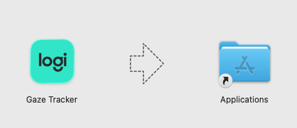
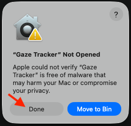
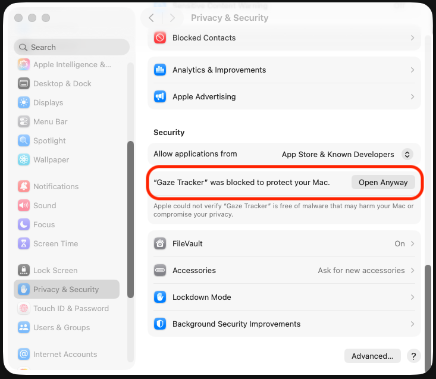
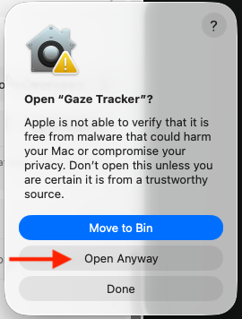
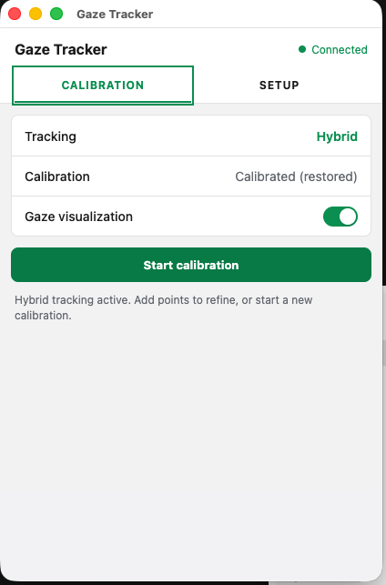

# Logi Gaze Tracker — Quick Start

**Gaze Tracker** is a tray app that turns a webcam into an eye tracker. It estimates where you
are looking on the screen and streams the gaze point (px and mm) as JSON over a local websocket
(`ws://127.0.0.1:8964`), so your own apps, prototypes or scripts can use it with any websocket client.

- Available for **Windows** and **macOS** (Intel and Apple Silicon).
- Works with **any Logitech webcam**; best results at **Full HD (1920×1080)**.
- Runs fully locally; no account required. Needs camera permission and network access on first
  run (the MediaPipe model is fetched from a CDN).

## 1. Download

| Platform | Installer |
| --- | --- |
| Windows | [Gaze.Tracker.Setup.1.0.0.exe](https://github.com/Logitech/hackathons/releases/download/logi-gaze-tracker/Gaze.Tracker.Setup.1.0.0.exe) |
| macOS Intel | [Gaze.Tracker-1.0.0.dmg](https://github.com/Logitech/hackathons/releases/download/logi-gaze-tracker/Gaze.Tracker-1.0.0.dmg) |
| macOS Apple Silicon (M1+) | [Gaze.Tracker-1.0.0-arm64.dmg](https://github.com/Logitech/hackathons/releases/download/logi-gaze-tracker/Gaze.Tracker-1.0.0-arm64.dmg) |

The builds are **unsigned**, so the OS will warn you once on first launch.

## 2. Install

### macOS

1. Open the `.dmg` and drag **Gaze Tracker** onto **Applications**.

   

2. Launch it from Applications. macOS blocks it the first time. Click **Done** (not *Move to Bin*).

   

3. Open **System Settings → Privacy & Security**, scroll to **Security** and click **Open Anyway**
   next to *"Gaze Tracker" was blocked*.

   

4. Confirm with **Open Anyway** (you may be asked for your password), then allow **camera** access
   when prompted.

   

5. The app lives in the menu bar (tray icon). Open **Controls…** from the tray icon to get the window below.

   

### Windows

Run the installer. If SmartScreen shows *"Windows protected your PC"*, click **More info → Run anyway**
and accept installing the unsigned software. Allow camera access when asked, then open **Controls…**
from the tray icon.

## 3. Configure the rig (Setup tab)

Do this once per **camera + screen** combination. The tracker needs to know the physical geometry.

1. In **Setup**, pick the **Camera** and set **Resolution** (use 1920×1080 if available).
2. Expand **Rig setup** and adjust the values for your hardware, then press **Apply rig**:
   - **Camera width/height (px)**: must match the capture resolution exactly.
   - **Focal length fx/fy, principal point cx/cy (px)**: camera intrinsics for that resolution.
   - **Screen width/height (mm)**: physical size of the active display area.
   - **Camera right of / below center, forward (mm)**: camera position relative to the screen
     center (a camera mounted above the screen uses a negative *below center* value).
   - **IPD (mm)**: your interpupillary distance (about 62 mm is typical).
   - **Pixels passed to MediaPipe**: leave *Mirrored horizontally* unless gaze moves the wrong way
     horizontally.

> The prefilled values describe one measured setup, **not universal defaults**. Measure yours.
> Applying a different rig, or changing camera, **clears the calibration**.

## 4. Calibrate

Calibration is unavailable until a rig is applied.

1. Sit at your normal distance, face the camera and keep your head reasonably still.
2. In **Calibration**, click **Start calibration** (or tray icon → *Start Calibration*).
3. Look at each of the nine points on the fullscreen pass and click or press **Space** to sample it.
   **Esc** cancels.
4. When finished, the window shows **Tracking: Hybrid** and **Calibration: Calibrated**. Turn on
   **Gaze visualization** to see where the tracker thinks you are looking.

**Refine:** once calibrated, use **Add points** to run another nine-point pass, e.g. after moving
your head or seat position, or from a different posture or distance. More positions give better
coverage.

**Start over:** **New calibration** discards the previous calibration entirely before starting a
fresh pass.

## 5. Use the gaze data

With the app running and calibrated, connect to `ws://127.0.0.1:8964` and send
`{"type":"start_stream"}`. See the [sample-code README](../sample-code/README.md) for the protocol,
a browser demo (`gaze-viewer.html`) and a Python logger (`gaze_logger.py`).

